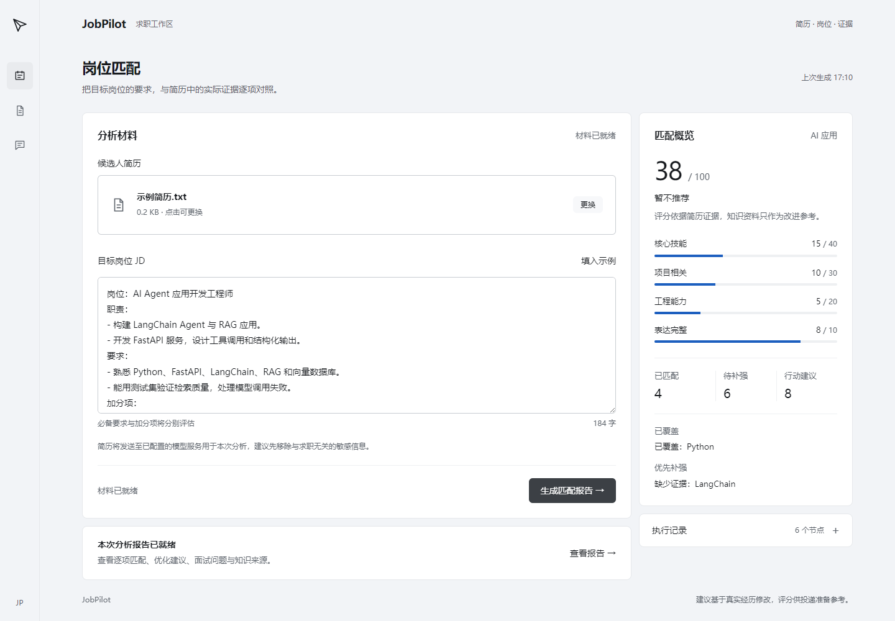
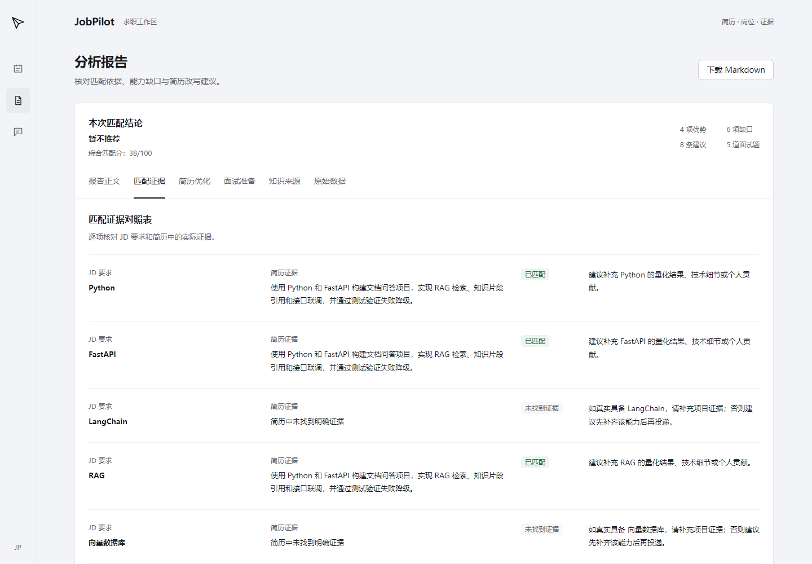
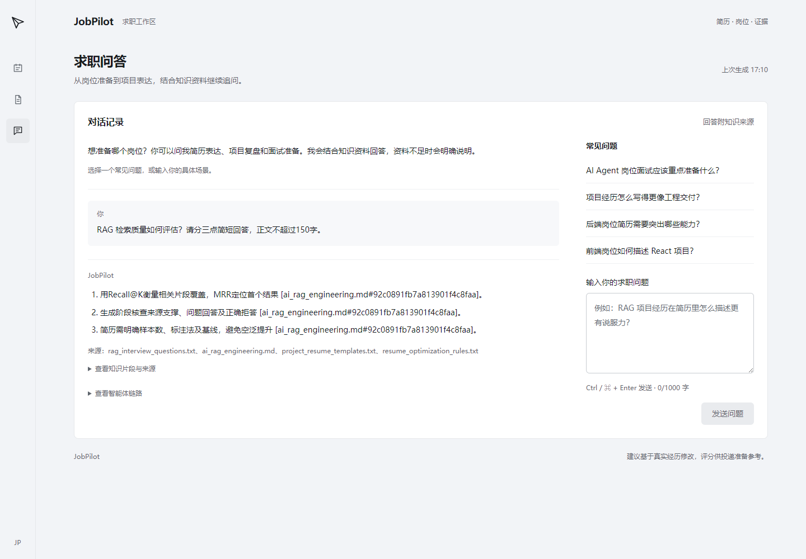
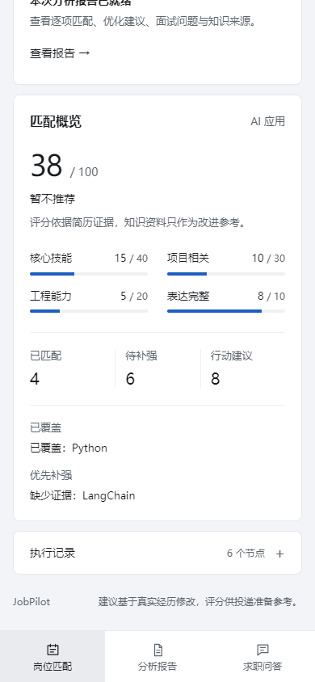
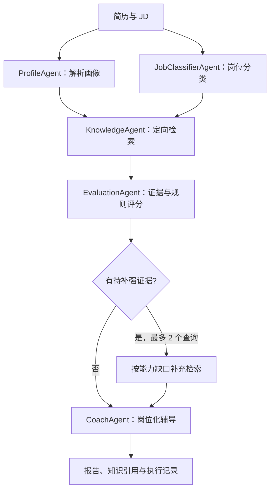

# JobPilot Agent

JobPilot Agent 是一个面向求职场景的多智能体简历匹配 MVP。它可以根据上传的简历和目标岗位 JD，完成岗位方向识别、简历信息解析、匹配度评分、能力差距分析、改写建议生成，并输出可下载的 Markdown 分析报告。

项目后端基于 FastAPI，使用显式依赖工作流编排 Agent，结合本地 RAG 知识库和可选 MCP 工具服务；前端基于 Vite + React，提供简历上传、JD 输入、结果展示和报告下载能力。

## 界面预览

以下截图使用虚构示例简历与岗位信息，展示平台的实际界面。

### 岗位匹配工作台

上传简历、填写岗位 JD，在同一工作区查看综合匹配分、分项评分与优先补强项。



### 匹配证据与分析报告

逐项对照岗位要求、简历证据和改进建议，并切换查看简历优化、面试准备、知识来源或下载报告。



### 知识库求职问答

围绕技术面试和项目表达继续追问，回答附带知识来源，支持展开查看依据。



<details>
<summary>查看移动端匹配概览</summary>

手机布局保留分项评分、证据摘要和底部工作区导航。



</details>

## 核心功能

- 上传简历文件并提取可读文本。
- 粘贴目标岗位 JD，解析岗位要求和关键词。
- 将简历和 JD 结构化为 JSON 数据。
- 按章节检索本地职业知识，支持中文、BM25 排序和可选向量辅助排序。
- 自动识别岗位方向：AI、后端、前端或通用岗位。
- 计算综合匹配分、分项得分、匹配证据和能力缺口。
- 生成简历摘要、技能、项目经历的优化建议。
- 生成面试问题和 Markdown 格式分析报告。
- 提供职业问答接口，用于基于知识库回答求职相关问题。
- 展示知识片段、引用来源、节点耗时、运行方式与降级记录。
- 可选运行本地 MCP Server，用于匹配评分和 Markdown 导出演示。

## 技术栈

- 后端：Python、FastAPI、Pydantic、DashScope 兼容模型工厂。
- Agent：依赖编排、独立节点并行、条件补充检索、确定性证据评分、模型失败规则兜底。
- RAG：TXT/Markdown、章节分块、中文二元词、BM25、可选 Chroma + RRF 融合排序、持久化增量索引。
- 前端：Vite、React、Axios、React Markdown。
- 扩展：MCP Python SDK。

## 项目结构

```text
jobpilot-agent/
|-- backend/
|   |-- agent/          # 各类 Agent 与工具逻辑
|   |-- api/            # FastAPI 路由
|   |-- config/         # 模型与配置读取
|   |-- data/           # 本地 RAG 知识文件
|   |-- mcp_server/     # 可选 MCP 服务
|   |-- rag/            # 知识检索服务
|   |-- scripts/        # 离线检索评测
|   |-- tests/          # 检索、编排、评分与 API 回归测试
|   |-- schemas/        # Pydantic 数据模型
|   |-- services/       # 业务编排服务
|   `-- main.py         # 后端入口
|-- frontend/
|   |-- src/            # React 应用源码
|   |-- package.json
|   `-- vite.config.js
`-- README.md
```

## 后端启动

```bash
cd backend
pip install -r requirements.txt
copy .env.example .env
uvicorn main:app --reload --port 8000
```

如果在 PowerShell 中复制环境变量文件，也可以使用：

```powershell
Copy-Item .env.example .env
```

在 `backend/.env` 中配置 `DASHSCOPE_API_KEY` 后，系统会调用大模型能力。未配置 API Key 时，项目会使用确定性的兜底 Agent，因此仍然可以启动后端、联调接口和体验前端主流程。

后端启动后可访问：

- 健康检查：`http://localhost:8000/`
- Swagger 文档：`http://localhost:8000/docs`
- 简历分析接口：`POST /api/analyze`
- 职业问答接口：`POST /api/chat`

## 前端启动

前端遵循 [Taste Skill 的应用界面规范](https://github.com/Leonxlnx/taste-skill/blob/main/skills/taste-skill/references/app-screens.md)，设计要求已落入 [frontend/DESIGN.md](frontend/DESIGN.md) 和 [frontend/AGENTS.md](frontend/AGENTS.md)。界面分为岗位匹配、分析报告、求职问答三个工作视图，切换时保留材料和对话。生产构建可通过 `npm run build` 后运行 `npm run preview` 查看。

```bash
cd frontend
npm install
npm run dev
```

默认访问地址：

```text
http://localhost:5173
```

前端会请求本地后端服务，请确保后端已经运行在 `http://localhost:8000`。

## 环境变量

后端示例配置位于 `backend/.env.example`：

```env
DASHSCOPE_API_KEY=
DASHSCOPE_CHAT_MODEL=qwen-plus
DASHSCOPE_EMBEDDING_MODEL=text-embedding-v4
RAG_ENABLE_VECTOR=false
```

说明：

- `DASHSCOPE_API_KEY`：DashScope API Key，用于启用真实大模型调用。
- `DASHSCOPE_CHAT_MODEL`：聊天和分析任务使用的模型名称。
- `DASHSCOPE_EMBEDDING_MODEL`：向量检索使用的 Embedding 模型名称。
- `RAG_ENABLE_VECTOR`：默认 `false`，设为 `true` 并配置 Key 后启用可选向量辅助检索。

当前模型工厂使用 DashScope SDK 集成，模型名称按环境变量读取。文本知识库默认采用文本 Embedding；可用模型和地域权限请参照[阿里云文本向量文档](https://help.aliyun.com/zh/model-studio/text-embedding-v4)。

也支持 `qwen3.8-flash` 搭配 `qwen3.7-text-embedding-flash`。新系列模型自动使用所需的多模态接口，输入输出仍作为文本交给各 Agent；`DASHSCOPE_ENABLE_THINKING` 默认 `false`。`DASHSCOPE_EMBEDDING_MODEL` 必须填写 Embedding 模型，不能填写 `*-rerank`；后者用于对已有候选排序，不能生成入库向量。Qwen3.7 Embedding 请求按最多 20 条分批，切换 Embedding 模型时使用独立 collection。

### Windows 真实模型与 Chroma 启动

使用项目独立虚拟环境，避免全局 Python 中缺失或冲突的依赖：

```powershell
python -m venv .venv
.\.venv\Scripts\python.exe -m pip install -r backend/requirements-windows.txt
```

把 Key 写入 `backend/.env`，不要写进受 Git 跟踪的 `.env.example`。项目也支持从操作系统环境变量读取 Key；两处同时存在时，操作系统变量优先。

```env
DASHSCOPE_API_KEY=在本机填写有效Key
DASHSCOPE_CHAT_MODEL=qwen-plus
DASHSCOPE_EMBEDDING_MODEL=text-embedding-v4
RAG_ENABLE_VECTOR=true
CHROMA_API_IMPL=chromadb.api.segment.SegmentAPI
CHROMA_PERSIST_DIRECTORY=chroma_db_segment
ANONYMIZED_TELEMETRY=false
```

从项目根目录启动：

```powershell
powershell -ExecutionPolicy Bypass -File backend/start-real.ps1
```

脚本先发送一条最小模型请求，并将本地职业知识资料发送至 DashScope Embedding 接口完成入库与检索探测；两项都通过后才在 `127.0.0.1:8000` 启动后端。向量数据库保存在本地 `backend/chroma_db_segment`。`-CheckOnly` 仅执行检查，`-Port 8001` 可指定其他端口。

手动检查配置（不调用模型）和真实服务（会调用 API）：

```powershell
.\.venv\Scripts\python.exe backend/scripts/check_runtime.py
.\.venv\Scripts\python.exe backend/scripts/check_runtime.py --probe
```

真实检查应看到 `model_probe: success`、`retrieval_status: hybrid` 和非零 `indexed_chunks`。如果返回 `AllocationQuota.FreeTierOnly`，说明免费额度耗尽且继续按量调用受限；请在百炼控制台检查这两个模型的额度与“用完即停”开关，或更换有额度的 Key。允许按量调用可能产生费用；参照[官方错误码说明](https://help.aliyun.com/zh/model-studio/error-code)。模型工厂采用单次尝试，避免对额度错误反复重试。

## Agent 编排与评分



画像解析与岗位分类并行，后续节点遵循依赖。补充检索只服务辅导，不重复评分，不运行无界反思循环。`backend/config/agent.yaml` 的 `max_gap_queries` 默认 2，设为 0 可关闭，上限 3。

评分完全使用简历与 JD，包含技能 40、项目 30、工程能力 20、表达完整度 10 分。技能中同时存在必备项和加分项时，权重为 85% / 15%；技术词使用边界匹配，避免 JavaScript 被误识别为 Java。仅出现在技能清单中的能力标为部分覆盖，有项目或工作证据才标为匹配。模型用于画像提取和辅导，不再生成随后又被覆盖的评分。

这些分数是可复现的启发式指标，尚未用招聘结果校准；规则解析对复杂语句、否定表达和技术同义词仍有局限。模型改写有提示词约束和已知技能检查，事实仍需结合原始简历复核。

同步分析、模型调用和 PDF/DOCX 解析在线程池运行，避免占用 FastAPI 事件循环。各请求独立记录 `agent_traces`，模型错误只记录错误类别，不记录提示词或简历正文。

## 知识库维护

知识库从 7 份简短文本扩展为 12 份文件，目前按章节生成 27 个片段。覆盖 AI/RAG/Agent、后端数据库与缓存、前端组件与可访问性，以及应届生、转岗、STAR 和能力证据表达。

新增技术资料参考了 [LangChain 检索](https://docs.langchain.com/oss/python/langchain/retrieval)、[Agent 工作流](https://docs.langchain.com/oss/python/langgraph/workflows-agents)、[MySQL EXPLAIN](https://dev.mysql.com/doc/refman/8.4/en/explain.html)、[Redis 缓存](https://redis.io/docs/latest/develop/use-cases/cache-aside/)、[FastAPI 并发](https://fastapi.tiangolo.com/async/)、[React 状态设计](https://react.dev/learn/thinking-in-react)及 [W3C 表单标签](https://www.w3.org/WAI/tutorials/forms/labels/)。面试题、项目证据与求职建议是项目维护者的整理与推演，并非官方招聘要求；原有 TXT 为演示资料。

扩充步骤：

1. 在 `backend/data/` 下添加 UTF-8 的 `.md` 或 `.txt`，支持子目录。Markdown 推荐每个 `##` 章节说明一个问题，并给出可操作建议。
2. 在 `backend/data/catalog.json` 中使用相对路径登记 `domain`（`ai/backend/frontend/general`）、标题、标签、参考 URL 和复核日期。未登记的文件默认归入 `general`；请为方向性资料明确填写领域。
3. 在 `backend/tests/fixtures/retrieval_cases.json` 中新增真实问题、预期来源与章节，并运行检索评测。不要将简历、API Key 或无授权的内部资料放入公共知识库。

检索会扫描全部候选片段后按 BM25 排序；优选文件只是小幅加权，不会按文件顺序提前截断。按岗位领域过滤后允许通用资料，单文件默认最多 2 个片段；中文使用二元词，技术名词保留英文边界。对缺少词面支持的结果保守拒答，因此语义同义表达仍可能漏召回。

设置 `RAG_ENABLE_VECTOR=true` 并配置了 Key 和向量依赖时，在满足词面相关性门槛的候选上使用向量排名与 BM25 做 RRF 融合。默认使用本地检索；未配置、依赖缺失或向量服务失败时同样使用本地检索，API 的 `retrieval_status` 为 `fallback`；成功融合为 `hybrid`，未命中为 `miss`。

`backend/config/rag.yaml` 控制 `vector_enabled`、`top_k`、`chunk_size`、`chunk_overlap`、`context_max_chars` 和 `max_chunks_per_source`，环境变量优先于 `vector_enabled`。上下文预算包含片段正文、引用 ID 和来源 URL。

文件变动在下一次检索时刷新本地语料；Chroma 通过稳定片段 ID 复用已有索引，仅为新增或变化片段调用 Embedding，并删除失效片段。切换 Embedding 模型会使用独立 collection，旧版索引保留供手动清理。向量初始化失败后有 60 秒冷却期，避免连续重复失败；没有配置 Key 时不会创建向量索引。

## 测试与检索评测

在项目根目录执行：

```bash
pip install -r backend/requirements-dev.txt
python -m pytest backend/tests -q
python backend/scripts/evaluate_retrieval.py
cd frontend
npm run build
```

默认评测仅使用本地检索，不调用模型或 Embedding API。`evaluate_retrieval.py --vector` 可显式启用配置的向量服务。常规测试验证索引增量更新与故障行为；真实 Chroma 持久化用例使用离线假向量，需要设置 `JOBPILOT_RUN_CHROMA_INTEGRATION=1` 显式运行，缺少依赖时跳过。

当前 Windows/Python 3.11 环境中，Chroma 默认 Rust 后端曾在写入时触发原生访问异常。项目独立虚拟环境使用 `requirements-windows.txt`，并指定本地 `SegmentAPI` 后，真实 Chroma 的写入、检索、重启复用、更新和删除集成用例已验证通过；不需要启动 Chroma HTTP 服务。新目录保留了原 Rust 数据库，避免混用索引。Python 层降级可以处理普通依赖/服务异常，无法捕获原生进程崩溃；其他环境启用前仍应运行集成用例。

当前回归集含 15 条有答案问题和 3 条无答案问题，检查预期章节是否进入 Top-4、MRR@4 和无答案判断。该小型人工样例集用于防止功能退化，不代表生产召回率或模型回答准确率；建议持续加入实际脱敏提问与失败案例。

## 分析结果字段

`/api/analyze` 的响应保留基础匹配字段：

- `score`：综合匹配分。
- `level`：匹配等级。
- `matched_points`：已匹配优势。
- `missing_points`：缺失能力点。
- `suggestions`：优化建议。

同时包含更细的分析信息：

- `job_classification`：岗位方向、置信度和判断原因。
- `match_result.score_detail`：技能匹配、项目相关性、工程能力、简历质量分项得分。
- `match_result.evidence_items`：JD 要求、简历证据、匹配状态和改进建议。
- `rewrite_result`：简历摘要、技能、项目经历优化建议和面试问题。
- `markdown_report`：可下载或渲染展示的 Markdown 报告。
- `agent_logs`：Agent 执行过程日志。
- `agent_traces`：节点状态、规则/模型/检索模式、耗时和降级原因。
- `retrieval_status`：本次知识检索方式或未命中状态。
- `knowledge_evidence`：知识来源、章节、稳定片段 ID、片段正文和参考链接。
- `warnings`：模型降级或知识不足说明。

`/api/chat` 同样返回 `knowledge_evidence`，前端支持展开引用片段。独立新问题不再拼接上轮问题，带指代的追问才补充最近一轮用户话题。

## 可选 MCP 服务

```bash
cd backend
python mcp_server/server.py
```

MCP 是扩展层能力，主分析流程不依赖外部 MCP 服务，也不强制依赖付费第三方 Key。

## 安全说明

- 不要提交 `.env` 文件。
- API Key 仅从环境变量读取，不写入 YAML 或代码文件。
- 简历内容通常包含个人隐私，演示和测试时建议使用脱敏样例。
